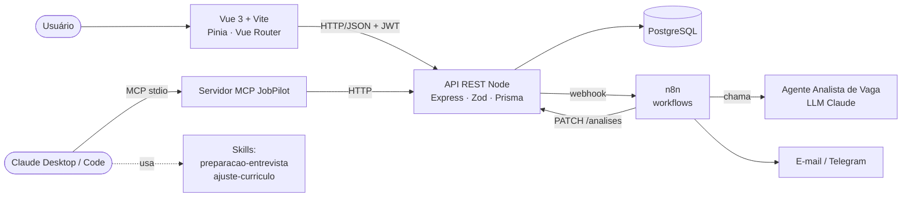
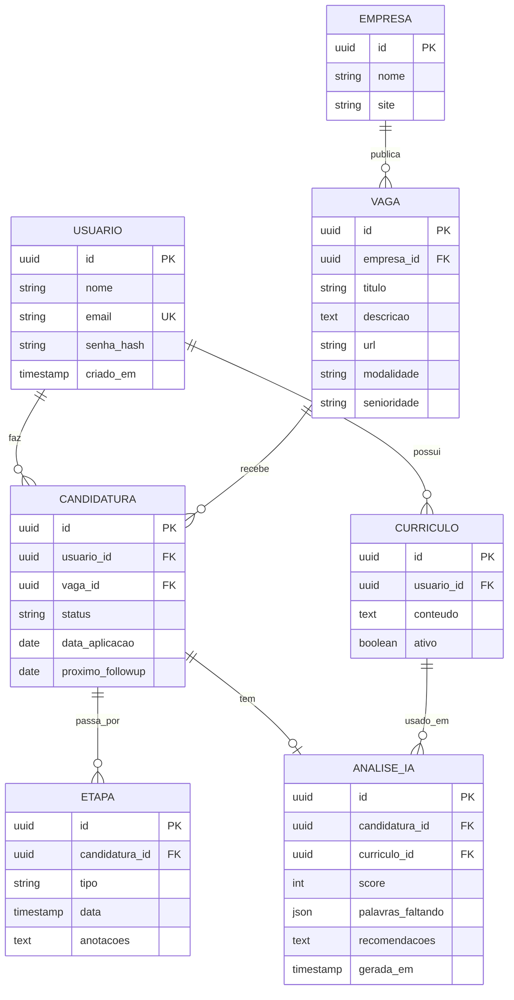
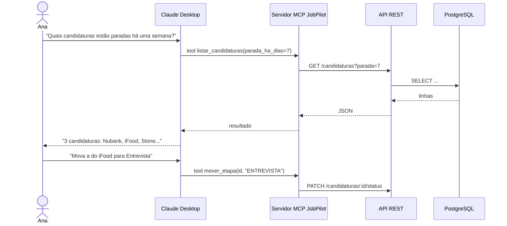
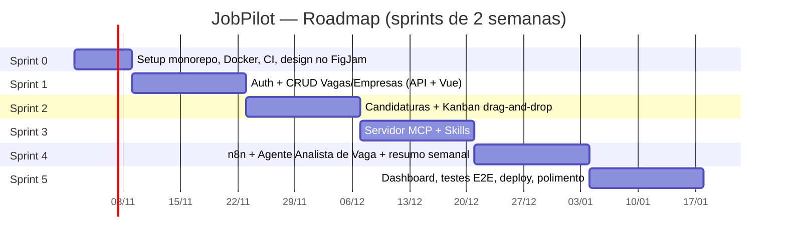
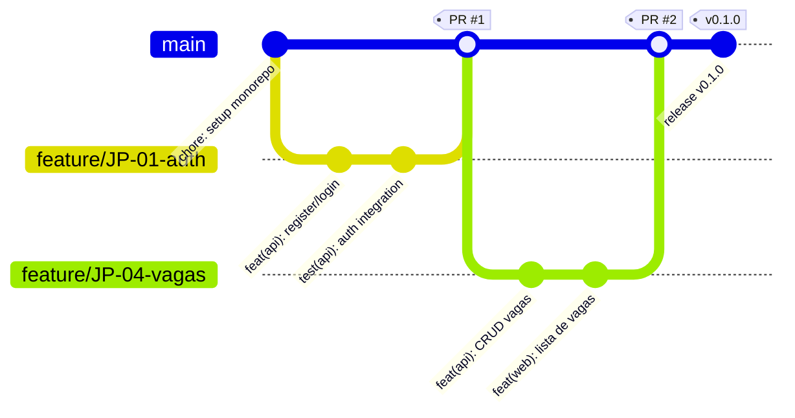
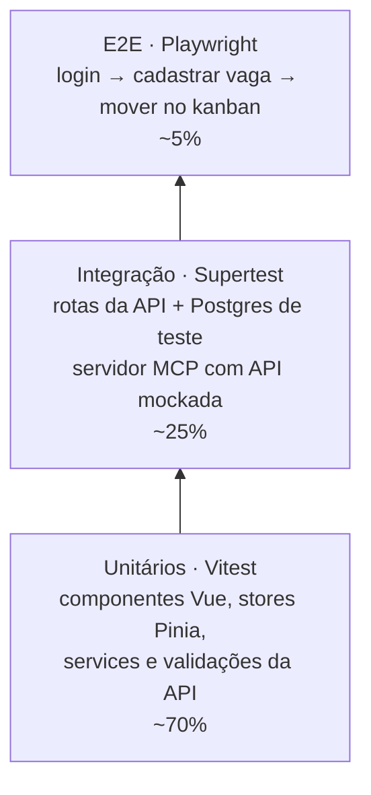

# JobPilot — Planejamento para o FigJam

> Gerenciador de candidaturas a vagas com IA.
> Stack: Vue 3 · Node.js (API REST) · PostgreSQL · Git/GitHub · MCP · Agentes de IA · n8n · Scrum/Kanban · Vitest/Supertest

**Como montar no FigJam:** cada seção abaixo vira uma *Section* do FigJam.
- Blocos ` ```mermaid ` → diagrama editável (conector do Figma `generate_diagram`, ou plugin de Mermaid no FigJam).
- Listas marcadas com 🟨 → um post-it por linha (cor sugerida no título).

---

## 1. Visão do produto

🟨 **Post-its amarelos — Problema**
- Candidatos perdem o controle de onde se candidataram
- Não sabem o quanto o currículo combina com cada vaga
- Esquecem de fazer follow-up com recrutadores
- Chegam despreparados nas entrevistas

🟩 **Post-its verdes — Solução**
- Kanban de candidaturas (Interesse → Aplicado → Entrevista → Oferta → Encerrado)
- Agente de IA que calcula compatibilidade currículo × vaga
- Lembretes automáticos de follow-up (n8n)
- Geração de perguntas prováveis de entrevista
- Conversar com seus dados pelo Claude via MCP

🟦 **Post-its azuis — Métricas de sucesso (MVP)**
- Cadastrar uma vaga em menos de 1 minuto
- Análise de compatibilidade em menos de 15 segundos
- 100% das candidaturas paradas há 7 dias geram lembrete
- Cobertura de testes ≥ 70% na API

**Persona:** *Ana, 27 anos, dev júnior em transição de carreira.* Aplica para 15–30 vagas por mês em Gupy, LinkedIn e sites de empresas. Usa planilha e perde prazos.

---

## 2. Arquitetura



🟪 **Post-its roxos — Decisões técnicas**
- Vue 3 + Composition API + Pinia (estado) + Vue Router
- Express + Zod (validação) + Prisma (ORM e migrations)
- PostgreSQL rodando em Docker no dev
- Autenticação JWT (access + refresh token)
- n8n self-hosted via Docker Compose
- Servidor MCP em TypeScript com `@modelcontextprotocol/sdk`
- Monorepo: `apps/web`, `apps/api`, `apps/mcp`, `n8n/`

---

## 3. Modelo de dados



---

## 4. API REST (endpoints)

🟧 **Post-its laranja — um por recurso**
- `POST /auth/register` · `POST /auth/login` · `POST /auth/refresh`
- `GET/POST /curriculos` · `PATCH /curriculos/:id/ativar`
- `GET/POST /empresas`
- `GET/POST /vagas` · `GET/PUT/DELETE /vagas/:id`
- `GET/POST /candidaturas` · `PATCH /candidaturas/:id/status`
- `GET/POST /candidaturas/:id/etapas`
- `POST /candidaturas/:id/analisar` → dispara webhook do n8n
- `PUT /analises/:candidaturaId` (usado pelo n8n, protegido por API key)
- `GET /dashboard/resumo` (contagem por status, média de score)

---

## 5. IA: MCP, agentes e skills



🟪 **Ferramentas do servidor MCP**
- `listar_candidaturas(status?, parada_ha_dias?)`
- `detalhar_vaga(id)`
- `cadastrar_vaga(titulo, empresa, url, descricao)`
- `mover_etapa(candidatura_id, status)`
- `analisar_vaga(candidatura_id)`
- Resource: `jobpilot://curriculo/ativo`

🟪 **Agentes de IA**
- **Analista de Vaga:** recebe vaga + currículo → retorna score 0–100, palavras-chave faltando, 3 recomendações (saída em JSON validada)
- **Coach de Entrevista:** gera 10 perguntas prováveis + pontos do currículo para destacar
- **Resumidor Semanal:** transforma os dados da semana em um relatório curto

🟪 **Skills (Claude Code / Claude Desktop)**
- `preparacao-entrevista` — usa o MCP para buscar a vaga e monta um roteiro de estudo
- `ajuste-curriculo` — sugere reescrita de tópicos do currículo para uma vaga específica

---

## 6. Workflows n8n

```mermaid
flowchart TD
    subgraph W1[Workflow 1 · Análise de vaga]
        A1[Webhook<br/>POST /analisar] --> A2[HTTP: busca vaga e currículo na API]
        A2 --> A3[AI Agent: Analista de Vaga]
        A3 --> A4{JSON válido?}
        A4 -- sim --> A5[HTTP: PUT /analises]
        A4 -- não --> A6[Retry 1x / registra erro]
    end
    subgraph W2[Workflow 2 · Follow-up diário]
        B1[Cron 9h] --> B2[HTTP: candidaturas paradas ≥ 7 dias]
        B2 --> B3{Tem alguma?}
        B3 -- sim --> B4[AI: rascunho de mensagem de follow-up]
        B4 --> B5[Telegram / E-mail]
        B3 -- não --> B6[Fim]
    end
    subgraph W3[Workflow 3 · Resumo semanal]
        C1[Cron segunda 8h] --> C2[HTTP: GET /dashboard/resumo]
        C2 --> C3[AI: Resumidor Semanal]
        C3 --> C4[E-mail]
    end
```



---

## 7. Scrum: papéis, cerimônias e regras

🟦 **Papéis**
- Product Owner: você
- Scrum Master: você
- Dev Team: você + Claude Code (pair programming)

🟦 **Cerimônias (sprint de 2 semanas)**
- Planning: segunda da semana 1 (1h)
- Daily: 10 min (registro escrito no README da sprint)
- Review: sexta da semana 2 (demo gravada)
- Retrospectiva: sexta da semana 2 (Start / Stop / Continue)

🟦 **Definition of Ready**
- História tem critério de aceite
- Estimada em story points
- Sem dependência bloqueante

🟩 **Definition of Done**
- Código revisado em PR
- Testes passando no CI
- Cobertura não caiu
- Documentado (README ou Swagger)
- Merge na `main`

---

## 8. Roadmap das sprints



---

## 9. Quadro Kanban da Sprint 1

Colunas: **Backlog da Sprint → A Fazer → Fazendo (WIP 2) → Code Review → Teste → Pronto**

🟨 **Post-its iniciais em "A Fazer"**
- JP-01 Cadastro e login com JWT (5 pts)
- JP-02 Modelo Prisma + migrations iniciais (3 pts)
- JP-03 CRUD de empresas na API (3 pts)
- JP-04 CRUD de vagas na API (5 pts)
- JP-05 Tela de login e cadastro em Vue (3 pts)
- JP-06 Lista e formulário de vagas em Vue (5 pts)
- JP-07 Testes de integração de auth e vagas (3 pts)

*Backlog completo com todas as histórias: `JobPilot-backlog.csv`.*

---

## 10. Git e CI



🟫 **Regras**
- GitHub Flow: `main` sempre estável, uma branch `feature/JP-XX-descricao` por história
- Conventional Commits (`feat`, `fix`, `test`, `docs`, `chore`, `refactor`)
- PR obrigatório, com checklist da Definition of Done
- GitHub Actions: lint → testes unitários → testes de integração (Postgres em service container) → build
- Versionamento semântico com tags por sprint

---

## 11. Estratégia de testes



🟥 **Post-its vermelhos — O que testar sem falta**
- Regras de transição de status da candidatura
- Autorização: usuário só vê os próprios dados
- Validação do JSON retornado pelo agente de IA
- Cálculo de "parada há X dias"
- Ferramentas do MCP chamam o endpoint certo
- Fluxo de drag-and-drop do kanban atualiza a API

---

## 12. Riscos

🟥 **Post-its vermelhos**
- Custo de chamadas de IA → limitar análises por dia, cache por vaga
- IA devolve JSON inválido → schema Zod + retry
- Escopo grande para uma pessoa → MVP sem IA até a Sprint 2; MCP e skills na Sprint 3 e a IA com n8n na Sprint 4 (ordem trocada na retrospectiva da Sprint 2)
- Dados pessoais do currículo → não logar conteúdo, `.env` fora do Git
